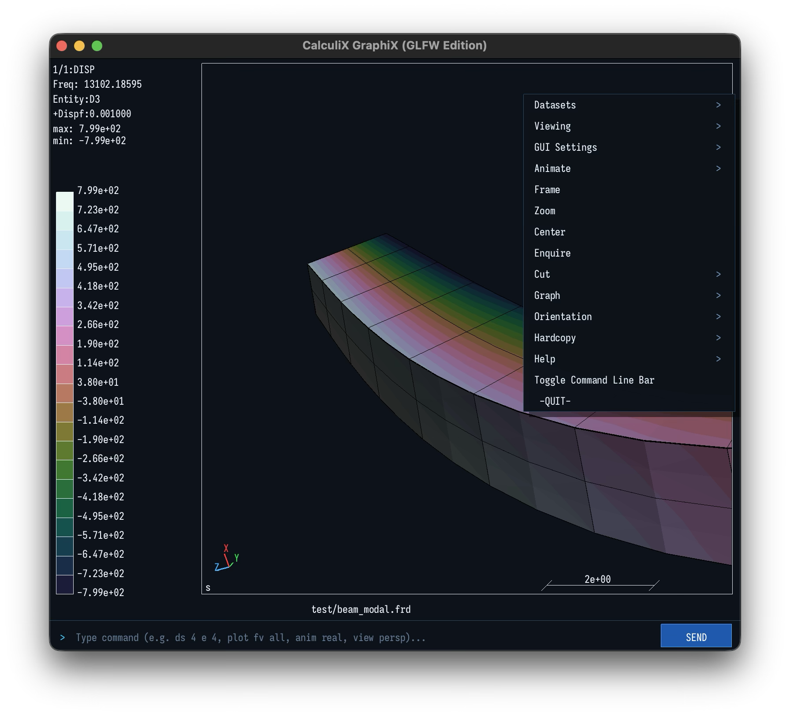

# CalculiX CrunchiX Multi-Solver Edition

[](LICENSE)
[](#quick-install)
[](#solver-backends)
[](#verification)
[](#verification)
[](#verification)
[](#verification)
[](#verification)
[](#verification)

[CalculiX CrunchiX (CCX)](https://www.dhondt.de/) is the open-source three-dimensional finite-element solver written by Dr. Guido Dhondt. This edition keeps his solver code unchanged and makes it easier to build and run on modern systems:

- **One-line installers** for Linux, macOS and Windows.
- **Modern sparse direct solvers**: MUMPS 5.x, Apple Accelerate and Intel oneMKL PARDISO, next to the classic SPOOLES 2.2.
- **A single cross-platform CMake build** with automatic BLAS/LAPACK selection.
- **`arpack-ng`** for modal and buckling analyses, replacing the unmaintained ARPACK 96.
- **Direct JSON result export** (`-j` / `--json`) for Python, Julia and MATLAB workflows.
- **Verified against the official CalculiX test suite** (635 decks), and kept in sync with upstream CCX.

The finite-element formulations, material models, contact algorithms, input syntax (`.inp`) and legacy outputs (`.dat`, `.frd`) are those of upstream CalculiX.

## Contents

- [Quick install](#quick-install)
- [Solver backends](#solver-backends)
- [Build system (CMake)](#build-system-cmake)
- [Verification](#verification)
- [Relationship to upstream CalculiX](#relationship-to-upstream-calculix)
- [Companion project: CalculiX GraphiX GLFW](#companion-project-calculix-graphix-glfw)
- [Documentation](#documentation)
- [About this project](#about-this-project)
- [Attribution and license](#attribution-and-license)

## Quick install

### Linux and macOS

```bash
/bin/bash -c "$(curl -fsSL https://raw.githubusercontent.com/carlomontec/CalculiX-CrunchiX-MultiSolver/main/install.sh)"
```

The installer asks its questions first, then installs the required packages, builds with CMake and installs the `ccx` executable (default `~/.local/bin`). If you accept the shell-configuration prompt, that directory is added to your `PATH`.

### Windows (PowerShell)

The installer detects or installs MSYS2 and the MinGW-w64 toolchain. In a Windows PowerShell prompt:

```powershell
$script = irm https://raw.githubusercontent.com/carlomontec/CalculiX-CrunchiX-MultiSolver/main/install.ps1
$script | Out-File -FilePath install.ps1 -Encoding utf8
Set-ExecutionPolicy Bypass -Scope Process -Force
.\install.ps1
```

Prerequisites, installer options and manual builds are described in [INSTALL.md](INSTALL.md).

## Solver backends

### Linear equation solvers

| Backend | Linux | macOS (Apple Silicon) | Windows | Notes |
|:---|:---:|:---:|:---:|:---|
| **MUMPS 5.x** | System package (default) | Built from vendored source | MSYS2 package (default) | Recommended open-source solver. Performance depends on the BLAS library (see [INSTALL.md](INSTALL.md#blas-and-lapack-selection)). |
| **Apple Accelerate** | - | System framework (default) | - | Native macOS sparse solver. |
| **Intel oneMKL PARDISO** | Optional | - | Optional | Requires Intel oneMKL. |
| **SPOOLES 2.2** | System package | Built from vendored source | System package when available | Classic CalculiX solver; reference baseline. |

Several backends can be compiled into one executable. A deck selects one explicitly with, for example, `*STATIC, SOLVER=MUMPS`; otherwise the build's default solver is used.

### Eigenvalue solver

Modal, frequency and buckling analyses use [`arpack-ng`](https://github.com/opencollab/arpack-ng), the maintained successor of ARPACK, installed from the system package manager.

## Build system (CMake)

This edition is built with a single top-level [`CMakeLists.txt`](CMakeLists.txt) on all three platforms. The installers are thin wrappers around it, and it can be used directly:

```bash
cmake -S . -B build -DCMAKE_BUILD_TYPE=Release
cmake --build build --parallel
```

What the build does:

- **Reads the source list from upstream's `src/Makefile.inc`**, so new or removed CalculiX source files are picked up automatically after each upstream sync.
- **Selects solvers per platform** through `CCX_USE_MUMPS`, `CCX_USE_ACCELERATE`, `CCX_USE_PARDISO` and `CCX_USE_SPOOLES`, and reports the enabled solvers and the default one at configure time.
- **Builds MUMPS and SPOOLES from pinned, checksum-verified source archives** on macOS, where no suitable system packages exist ([third_party/](third_party/)).
- **Chooses a BLAS/LAPACK library for the hardware** (`CCX_BLAS=AUTO`): Accelerate on Apple Silicon, AMD AOCL-BLIS on AMD Zen, OpenBLAS elsewhere, or oneMKL with PARDISO.

**Upstream CalculiX now has its own CMake build.** Since November 2026, Dr. Dhondt's CalculiX ships an official CMake build (`cmake/`, `CMakePresets.json`) with presets for GCC or Intel compilers, 32- or 64-bit integers, and the SPOOLES, PARDISO and PaStiX solvers. This is an important step for the CalculiX community. The build in this repository was developed independently and earlier, for a different scope (multiple solver backends, macOS and Windows). Both are kept in the tree: this edition's `CMakeLists.txt` is the supported build here, and upstream's files and instructions ([doc/INSTALL_upstream.md](doc/INSTALL_upstream.md)) are preserved unchanged for reference.

All build options are listed in [INSTALL.md](INSTALL.md#building-with-cmake).

## Verification

Every change is checked against Dr. Dhondt's official test suite (the decks in [`test/`](test/)). The runner in [`test_NewLib/`](test_NewLib/) runs the decks in parallel and compares the results numerically against golden JSON references, with a fallback to the classic `.dat` / `.frd` comparison:

```bash
# Quick check: 20 decks
python3 test_NewLib/run_official_testsuite.py --custom-bin ccx --limit 20

# Full suite
python3 test_NewLib/run_official_testsuite.py --custom-bin ccx
```

Reports (Markdown, CSV, JSON) are written to `test_NewLib/testsuite_results/`. The badges at the top show the latest pass rates per solver and platform. Full details are in [docs/VALIDATION.md](docs/VALIDATION.md).

## Relationship to upstream CalculiX

This repository is a fork of [Dhondtguido/CalculiX](https://github.com/Dhondtguido/CalculiX) and follows its development. Upstream changes are merged regularly with a real merge (not a copy), so upstream history and authorship are preserved. Each merge is verified against the full test suite and recorded in [docs/CHANGES_VS_CCX.md](docs/CHANGES_VS_CCX.md#10-upstream-synchronization-log). Last synchronized: November 2026 (upstream commit `57a4e71`).

The upstream `test/` directory is never modified; this edition's tests and tools live in `test_NewLib/`.

## Companion project: CalculiX GraphiX GLFW



[CalculiX GraphiX GLFW](https://github.com/carlomontec/CalculiX-GraphiX-GLFW) is a version of the CalculiX pre- and post-processor (CGX) with a modern GLFW/OpenGL renderer. It also runs on Linux, macOS and Windows, and binaries are available.

## Documentation

| Document | Content |
|:---|:---|
| [INSTALL.md](INSTALL.md) | Prerequisites, installers, CMake options, BLAS selection, troubleshooting |
| [docs/VALIDATION.md](docs/VALIDATION.md) | Running the official test suite and reading the results |
| [docs/JSON_EXPORT.md](docs/JSON_EXPORT.md) | JSON result export and schema |
| [docs/CHANGES_VS_CCX.md](docs/CHANGES_VS_CCX.md) | Technical reference: everything that differs from upstream CCX, and the upstream sync log |
| [docs/MODERNIZATION.md](docs/MODERNIZATION.md) | Architecture and roadmap |
| [docs/BENCHMARK_ACCELERATE.md](docs/BENCHMARK_ACCELERATE.md) | Apple Accelerate solver integration and benchmarks |
| [docs/STATE_OF_THE_ART_CONDA_FEEDSTOCK.md](docs/STATE_OF_THE_ART_CONDA_FEEDSTOCK.md) | Comparison with the conda-forge CalculiX package |
| [benchmarks/](benchmarks/README.md) | Solver performance benchmarks |
| [doc/](doc/) | Upstream CalculiX documentation (Dr. Dhondt) |

## About this project

The goal is a CalculiX that is easy to install on any major operating system and runs on modern, maintained numerical libraries, without changing the solver's validated physics.

The project was also developed as a practical exploration of the potential and the limitations of AI-assisted programming in a large scientific code base. AI tools were used for much of the new build, solver-interface and tooling code; every change is reviewed and verified against the official CalculiX test suite before it is merged.

## Attribution and license

CalculiX CrunchiX is free software under the GNU General Public License version 2 ([LICENSE](LICENSE)). CalculiX CrunchiX is written and maintained by Dr. Guido Dhondt; CalculiX GraphiX was created by Klaus Wittig. This edition is maintained by Dr. Carlo Monjaraz-Tec.

- CalculiX: [calculix.de](https://www.calculix.de) and [dhondt.de](https://www.dhondt.de)
- Community: [CalculiX Discourse](https://calculix.discourse.group)
- Theory: G. Dhondt, *The Finite Element Method for Three-Dimensional Thermomechanical Applications*, Wiley, 2004.

The solver libraries keep their own licenses: MUMPS is distributed under CeCILL-C, SPOOLES 2.2 is public domain, and Intel oneMKL and Apple Accelerate are subject to their vendors' license terms.
