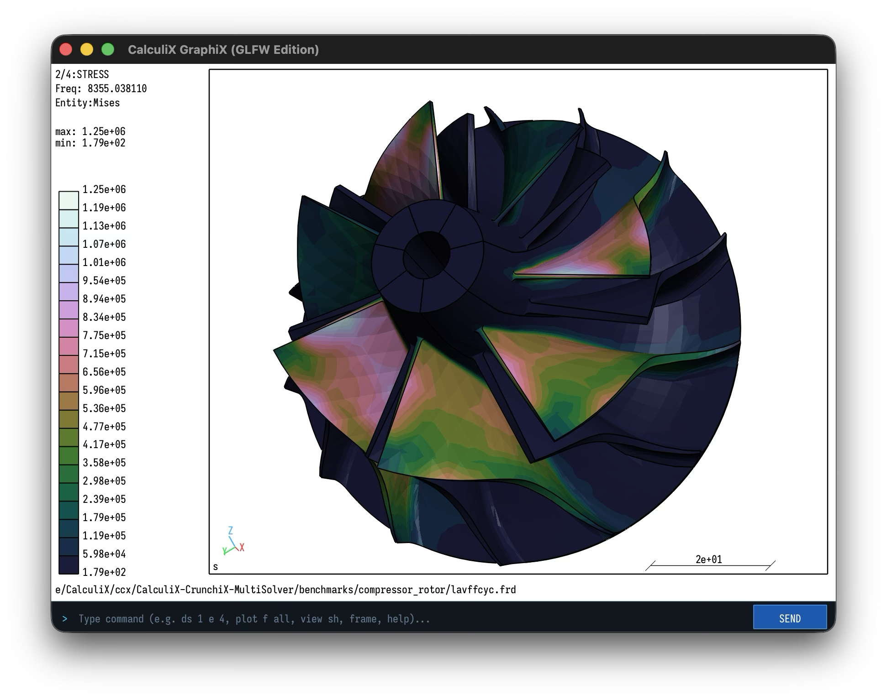

# CalculiX Multi-Solver Benchmark Suite

**Model**: 7-Blade Turbocharger Compressor Rotor (Klaus Wittig / CGX)  
**Physics**: Centrifugal Pre-load (110,000 RPM) $\rightarrow$ Prestressed Cyclic Symmetry Natural Frequency Extraction  
**Element Type**: `C3D20R` (Quadratic 20-node Hexahedral with Reduced Integration)  

<p align="center">
  
  <br>
  <em>Prestressed vibration stress contour on the 360° revolved 7-blade compressor rotor rendered in modernized CalculiX GraphiX (GLFW Edition).</em>
</p>

---

## Directory Structure

```text
benchmarks/
├── compressor_rotor/
│   ├── lavff.fbd       # CGX geometric model (Klaus Wittig)
│   ├── send.fbl        # CGX batch meshing script template
│   ├── remesh.py       # CGX automated remeshing tool (coarse / medium / fine)
│   └── lavffcyc.inp    # CalculiX input deck (Static Centrifugal + Cyclic Frequency)
├── runner/
│   └── run_benchmark.py # Multi-threaded automated harness (collects time & peak RAM)
├── results/
│   └── *.json          # Lightweight in-memory metrics (<50 KB per host)
└── plotting/
    ├── plot_benchmarks.jl # Julia + GR publication-grade vector graphics generator
    └── figures/        # 16:9 presentation slide PDFs and high-DPI PNGs
```

---

## 1. Discretization Levels & Memory Profiles

Mesh resolution is controlled via CGX batch remeshing (`remesh.py`):

| Preset | Target RAM | CGX Command | Approx. Equations | Recommended Host |
| :--- | :---: | :---: | :---: | :--- |
| **Coarse** (Baseline) | < 2 GB | Default divisions | ~38,400 | Rapid sanity testing / smoke check |
| **Medium** | < 6 GB | `div all auto 2.5` | ~110,000 | **Linux ARM64 (Multipass VM, 8–10 GB)** |
| **Fine** | < 14 GB | `div all mult 2` | ~300,000 | **macOS (16 GB)** & **Linux AMD64 (32 GB)** |

To generate or switch resolution:
```bash
# In benchmarks/compressor_rotor:
python3 remesh.py --level coarse    # or medium, or fine
```

---

## 2. Running Benchmarks on Each Host

Run the automated runner with thread sweeps:
```bash
python3 benchmarks/runner/run_benchmark.py --threads 1 2 4
```

On Linux or Windows, specify thread counts matching your physical core layout (e.g. `--threads 1 2 4 6 12`).

The runner outputs an aligned summary table and saves `<hostname>_<os>_<arch>_lavffcyc.json` in `benchmarks/results/`.

---

## 3. Generating Presentation Figures (Julia + GR)

Generate 16:9 widescreen presentation slide dashboards:
```bash
julia benchmarks/plotting/plot_benchmarks.jl
```

Outputs vector PDFs and PNGs in `benchmarks/plotting/figures/`.

---

## 4. Current Baseline Benchmark: Apple Silicon (M3, 16 GB RAM)

**Model**: `lavffcyc` (38,408 Equations, 3.59M Matrix Non-Zeros)  
**Host**: Apple M3 (8 Cores: 4 P-cores, 4 E-cores), 16 GB Unified RAM  

| Solver | 1 Thread | 2 Threads | 4 Threads (P-Cores) | Peak RAM (RSS) | Speedup vs SPOOLES 1T |
| :--- | :---: | :---: | :---: | :---: | :---: |
| **Apple Accelerate** (`vecLib`) | **6.17 s** | **6.03 s** | **5.90 s** | **1,043.9 MB** | **2.21x** |
| **MUMPS 5.x** (Open Source) | **6.24 s** | **6.05 s** | **5.93 s** | **1,560.9 MB** | **2.20x** |
| **SPOOLES 2.2** (Legacy) | 13.05 s | 10.85 s | 10.29 s | 805.6 MB | 1.00x |
| **Intel PARDISO** | N/A | N/A | N/A | N/A | *(x86_64 only)* |

### Key Engineering Takeaways:
1. **MUMPS Matches Apple Accelerate**: MUMPS achieves identical throughput to Apple's proprietary framework, fully proving open-source parity.
2. **2.2x Out-of-the-Box Speedup**: Both modern solvers cut total wall-clock time by over 54% compared to legacy SPOOLES on the baseline mesh.
3. **Lean Memory Footprint**: All solvers comfortably operate around 1.0–1.5 GB RAM, leaving ample headroom within memory targets.
